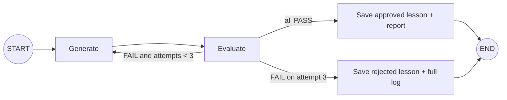

# Self-Evaluating Lesson Content Generator

An agentic Python application that writes a beginner-friendly lesson, checks it against a strict six-part rubric, and regenerates failed drafts up to two times. The assessment topic is **Introduction to RAG (Retrieval-Augmented Generation)**.

## Problem

A fluent answer can still be inaccurate, confusing, incomplete, or poorly taught. This project separates lesson generation from quality review, requires evidence and correction guidance for failed criteria, and approves a lesson only when every rubric check passes.

## Features

- Standalone Markdown lesson generation grounded in a curated RAG reference.
- Independent LLM judge plus deterministic structure checks.
- Six binary criteria; uncertain or invalid evaluation fails safely.
- LangGraph workflow with one initial attempt and at most two retries.
- SQLite run history and explainable frequency-based guidance from recurring failures.
- Rejection history captures evidence, feedback, and next-attempt change summary.
- Controlled `--demo-failure` injects a known false claim into only the initial draft.
- OpenAI-compatible providers configured through environment variables.

## Architecture and workflow

See [docs/architecture.md](docs/architecture.md). In brief:



The generator and evaluator use separate prompts. SQLite supplies historical feedback as advisory prompt guidance; current reference material and the rubric remain authoritative.

## Technology

Python 3.11+, LangGraph, Pydantic v2, SQLite, OpenAI-compatible API client, python-dotenv, pytest.

## Project structure

```text
.
├── README.md
├── AGENTS.md
├── docs/{architecture.md,implementation_plan.md}
├── references/rag_primer.md
├── src/
│   ├── app/main.py                 # `python -m app.main` alias
│   └── lesson_generator/
│       ├── agents/generator.py
│       ├── evaluation/evaluator.py
│       ├── graph/workflow.py
│       ├── memory/store.py
│       ├── schemas.py
│       └── main.py
├── tests/
└── requirements.txt
```

## Install

Use Python 3.11 or newer:

```bash
python -m venv .venv
source .venv/bin/activate  # Windows: .venv\\Scripts\\activate
pip install -r requirements.txt
cp .env.example .env
```

Set `LLM_API_KEY`, `LLM_BASE_URL`, and `LLM_MODEL` in `.env`. `LLM_BASE_URL` may be an OpenRouter endpoint or another OpenAI-compatible API. Never commit `.env`.

## Run

```bash
PYTHONPATH=src python -m app.main --topic "Introduction to RAG"
```

Outputs are written under `outputs/`: `final_lesson.md` is present only for an approved run; rejected runs write `rejected_lesson.md`. Both outcomes include `evaluation_report.json`; failed attempts are recorded in `rejection_log.json`. SQLite defaults to `data/lesson_memory.sqlite3`. Override `DATABASE_PATH` and `OUTPUT_DIR` as needed.

Progress and final status are printed to the terminal. A successful run returns exit code 0; a rejected or failed run returns nonzero.

## Deliberate failure demonstration

```bash
PYTHONPATH=src python -m app.main --topic "Introduction to RAG" --demo-failure
```

The demo appends the known false claim “RAG always fine-tunes the language model using retrieved documents” to the first generated draft. The evaluator flags this contradiction with the curated reference. The following attempt receives correction feedback. The injected claim is marked as demo-only and is sanitized in memory before persistence; the rejection log still preserves the observed failure evidence.

## Tests

```bash
PYTHONPATH=src python -m pytest -q
```

Unit tests use mocked generators, evaluators, and client responses. An optional live-provider check can be run with `RUN_LLM_INTEGRATION=1` and valid environment configuration.

## Example outcome

```text
Attempts: 2
Status: PASS
Outcome: approved
Outputs: outputs
```

## Design decisions and trade-offs

- A separate judge reduces self-approval risk; the rubric contract enforces all-six-pass status.
- Deterministic checks catch missing structure and the explicit demo contradiction; semantic quality still relies on the judge model.
- SQLite and frequency counts provide transparent, low-cost memory without a vector database.
- Historical guidance is topic-scoped and advisory. It cannot alter the evaluator or replace the reference.
- Three attempts bound cost and prevent loops.

## Limitations

LLM judgments can vary and factual coverage is limited to the small curated reference. Frequency guidance uses exact topic matching and simple counts, not semantic retrieval. The demo's deterministic contradiction check covers its known injected statement; broader factual checking depends on the judge. Outputs use fixed filenames, so concurrent runs targeting the same output directory may overwrite each other.
