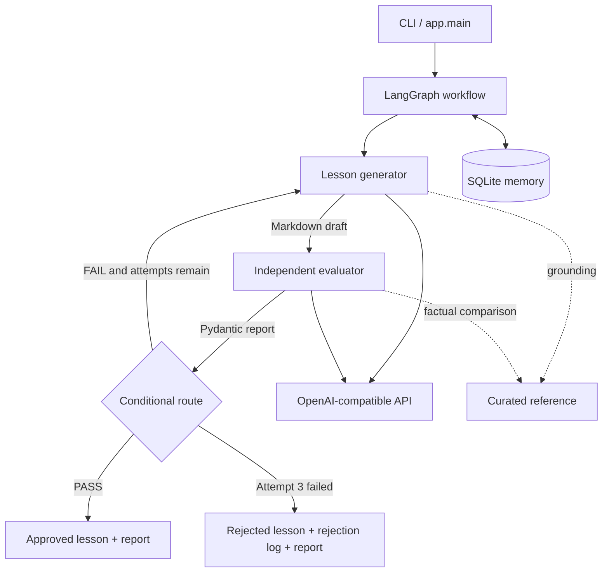

# System architecture

## Purpose

Generate a standalone beginner lesson and approve it only when six independent binary checks all pass. The reader is an Indian 12th-grade graduate with limited English vocabulary and no technical background. A short curated reference at `references/rag_primer.md` grounds claims about retrieval-augmented generation.

## System architecture

## LangGraph workflow and retry mechanism

`graph/workflow.py` builds `START → generate → evaluate → route`. The generation node increments the attempt count and refuses any generation after the configured ceiling (which itself is validated to be 1–3). The evaluator's structured status selects one of three routes:

- all six PASS → finalize and save `final_lesson.md` and `evaluation_report.json`;
- any FAIL with attempts remaining → create criterion-specific feedback and loop to generation;
- any FAIL on the last attempt → save `rejected_lesson.md`, complete `rejection_log.json`, and report, then end.

A rejected run removes a stale approved lesson in the same output directory. A successful first attempt clears a stale rejection log. Evaluator/API/parsing errors become a fail-closed report; generation/API failures propagate as workflow errors and the run is marked `error` in memory. There is no unbounded loop.

## Component responsibilities

- `agents/generator.py`: standalone Markdown lesson generation; takes topic, evaluator corrections, and advisory historical guidance.
- `evaluation/evaluator.py`: independent semantic LLM judge plus deterministic structure checks. Judge output is parsed and validated with Pydantic. Uncertainty, malformed output, or API failure cannot produce approval.
- `schemas.py`: lesson, per-criterion and aggregate report contracts and graph state types. Aggregate status must match the six criterion statuses.
- `graph/workflow.py`: attempt counter, feedback routing, output saving, rejection audit history, memory integration.
- `memory/store.py`: persistent SQLite run and attempt records; recurrence queries and historical guidance.
- `llm.py`: environment-backed OpenAI-compatible client configuration.
- `main.py` / `app.main`: command line entry point and readable outcome.

## Generator/evaluator separation

Generation and evaluation have distinct prompts and responsibilities. The generator receives the reference and revision feedback. The evaluator receives the reference and lesson, but not generator instructions or prior evaluator verdicts. This limits approval-by-prompt leakage. Historical failures only advise generation and cannot change the active reference or rubric.

## Evaluation rubric

Each result contains PASS/FAIL, explanation, lesson evidence, failure reasons, and correction instruction:

1. Accuracy and grounding.
2. Beginner-friendly language.
3. Teaching through examples.
4. No unexplained jargon.
5. Coverage of essential concepts.
6. Logical teaching flow.

Overall PASS is valid only when all six are PASS. Deterministic checks detect empty/malformed output, insufficient section structure, absent step-by-step examples, and the deliberate demo's known false claim. The LLM judge remains responsible for semantic factual accuracy, clarity, jargon and flow beyond these explicit checks.

## SQLite memory design

`runs` stores run ID, topic, final status and UTC timestamp. `attempts` stores each Markdown draft, structured evaluation JSON, failed criteria, feedback, successful corrections and timestamp, keyed by run ID and attempt. SQLite uses the standard library; no vector database is needed.

Before generation, memory queries completed runs with an exact topic match. Criteria failing at least twice yield concise, count-bearing guidance built from recorded feedback. This is transparent and topic-scoped. The generator prompt labels it advisory and gives the current reference and task priority. Every completed evaluation is recorded, so subsequent runs update the signal. In demo mode, the injected sentence is redacted in the stored lesson while its failure finding remains auditable.

## Error handling

Missing key/model settings raise actionable configuration errors. Client/API exceptions, malformed JSON, schema validation failures, and empty evaluator responses yield a complete FAIL report. Generator errors terminate the workflow as errors instead of silently returning a lesson. CLI returns nonzero for rejection or runtime error. No API key is embedded in source; `.env` is git-ignored.

## Design decisions and trade-offs

- SQLite and exact-topic frequency counts are deliberately simple and inspectable; they do not provide semantic cross-topic matching.
- The three-attempt limit bounds latency and provider cost.
- Fixed output filenames suit a single local assessment run but concurrent writes to one output directory can collide.
- LLM-as-a-judge improves semantic coverage beyond deterministic checks, but remains model-dependent. The curated reference is intentionally small and does not guarantee comprehensive truth checking.
- Demo error injection is isolated to an explicit CLI flag and redacted from persistent lesson content.
